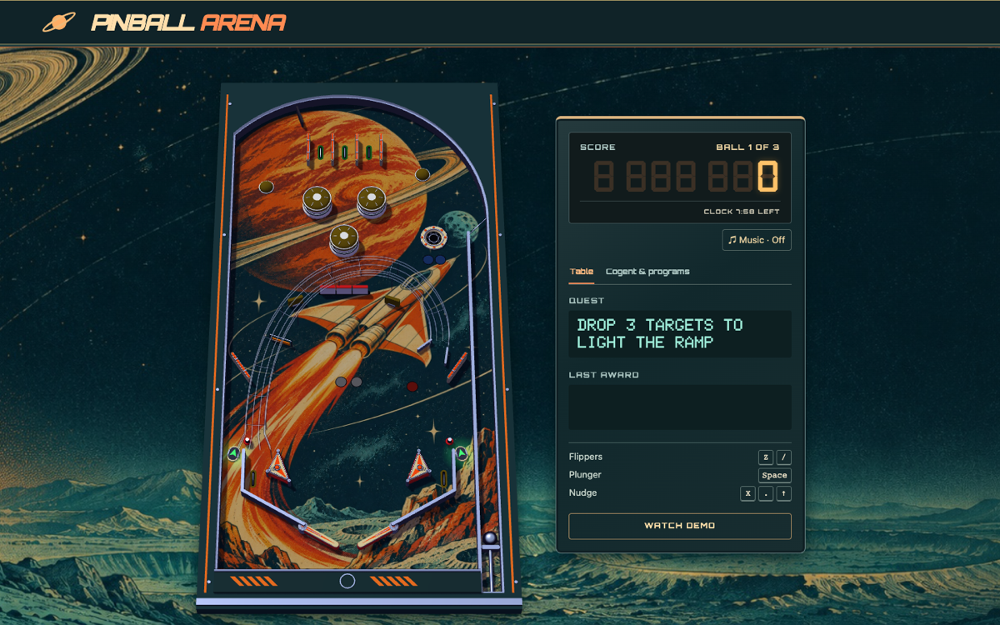

# Pinball Arena

A two-player pinball game that runs in a web browser. A person plays the flippers. Their
Softmax cogent (AI agent) builds the table and defines its rules, with BASIC programs or by
direct control through the game API. With no cogent connected, the bundled house program
runs the table. The cogent can play the flippers too, the same two ways.



The game is a standalone fork of [Polyworld](https://github.com/softmax-universe/polyworld)
(Nim, compiled to WebAssembly). It is live at **https://pinball-arena.vercel.app** for signed-out
play. Sign-in does not work there yet, and the cogent connection has only been tested against
fakes; see [What is not verified](#what-is-not-verified).

## The two seats

| Seat | Who holds it | Aim | What it does |
| --- | --- | --- | --- |
| **Flipper player** | A person at the page, or the cogent (a BASIC program or direct control) | The highest score in the Episode | Works the two flippers, the plunger and nudges |
| **Arena player** | A BASIC table program (the bundled `house` at first), and the cogent's direct control beside it | That the Flipper player has fun and gets better. It has no score of its own and is not trying to win | Builds the table and defines every rule: nothing scores unless a rule says so |

An Episode is a build phase (10 seconds at most), then three balls, and at most 8 minutes
of play.

## The game API

Everything the cogent does goes over its one connection with the page (AIDE 1.0.0):

- `policy.create` / `policy.update` deploy a BASIC program. A first comment line
  `' @seat flipper` makes it a Flipper program; otherwise it is a table program.
- `surface.act` carries one request to the game: run BASIC calls at once for either seat
  (`flip(left, 1)`, `create(...)`, `doscore(...)`), read the state of the table, list,
  activate and remove the stored programs, or subscribe to the game's messages.
- `surface.event` carries what the game tells the cogent: the summary of each Episode, a
  program failure, and, once subscribed, the table events and display changes.

[`web/guide/game-api.md`](web/guide/game-api.md) is the reference. The game runs in the
browser, so there is no game server: the page answers the cogent itself.

## Start here

- **The guides the page sends to the cogent** with every chat message, in this order:
  [`web/guide/game-api.md`](web/guide/game-api.md) (what the cogent sends and gets),
  [`web/guide/arena-basic.md`](web/guide/arena-basic.md) (building a table) and
  [`web/guide/flipper-basic.md`](web/guide/flipper-basic.md) (playing one).
- **Design:** [`docs/designs/pinball-arena-2026-11-16.html`](docs/designs/pinball-arena-2026-11-16.html)
  (Final). It decides how the game looks, feels and behaves. Appendix I lists what is settled.
- **How the code is put together:** [`docs/architecture.md`](docs/architecture.md), including
  where the build departs from the design.
- **The BASIC interface of both seats:** [`src/pinball/script/README.md`](src/pinball/script/README.md)
  (reference). [`players/house.bas`](players/house.bas) and
  [`players/demo_flipper.bas`](players/demo_flipper.bas) are the full examples.
- **The server part:** [`server/README.md`](server/README.md).
- **Assets and their licences:** [`assets/LICENSES.md`](assets/LICENSES.md).

## Set up

You need Nim 2.2.10 or newer, [nimby](https://github.com/treeform/nimby), Node 24, and for the
browser build an [emsdk](https://emscripten.org/docs/getting_started/downloads.html)
(built with Emscripten 6.0.12).

```sh
mkdir -p deps && cd deps && nimby sync ../nimby.lock && cd ..
```

This checks out the pinned Nim packages into `deps/` (git-ignored). `config.nims` adds them to
the compiler's path. There are no npm dependencies.

## Play

```sh
tools/build_web.sh        # builds web/game/pinball.{js,wasm,data}, about 10 s
npm run dev               # serves web/ on http://localhost:8080
```

`tools/build_web.sh` finds `emcc` on the path, or sources the emsdk at `$EMSDK`
(default `~/coding/tools/emsdk`). Signed-out play needs no server part: any static file
server over `web/` works.

Click the table to give it the keyboard.

| Action | Keyboard | Gamepad |
| --- | --- | --- |
| Left flipper | Z or Left Shift | Left trigger or bumper |
| Right flipper | / or Right Shift | Right trigger or bumper |
| Plunger | Space (hold to pull, release to fire) | Right stick down, then release |
| Nudge | X (left), . (right), Up | Left stick flick |

"Watch demo" hands the flippers to the bundled demo program. The programs list in the side
drawer shows the stored programs of both seats; a click makes one active.

Native build, for development:

```sh
nim r src/pinball/pinball.nim             # a window with the table
nim r src/pinball/pinball.nim --demo      # the demo program plays the flippers
nim r src/pinball/pinball.nim --demo --screenshot shot.png --ticks 4200 --size 620x1000
```

## Deploy

The site is the Vercel project `pinball-arena`. Vercel cannot build the game, so a deployment
is made from a machine that has built it:

```sh
tools/build_web.sh
vercel deploy --prod
```

`.vercelignore` decides what is uploaded: `web/` (with the built `web/game/`), `api/`,
`server/`, `vercel.json` and `package.json`. The project has `COGENT_SECRET` and `SITE_ORIGIN`
set for production; see [`server/README.md`](server/README.md).

## Try a program without a browser

```sh
nim r src/pinball/headless.nim                               # house table, demo flipper
nim r src/pinball/headless.nim --arena my_table.bas          # your own table program
nim r src/pinball/headless.nim --flipper my_flipper.bas      # your own Flipper program
nim r src/pinball/headless.nim --record episode.replay
nim r src/pinball/headless.nim --replay episode.replay       # verify a recording
```

It plays one Episode, prints the Episode summary (the same JSON the page reports to the
cogent), and checks that the replay re-simulates to the same state on every tick. It exits
with 1 if a program does not compile or the replay does not match. A program that fails
while running is printed to standard error, and the summary carries the error. A Flipper
program needs no `' @seat flipper` line here: `--flipper` says which seat it is for.

## Test

```sh
tools/test.sh
```

Runs every `tests/test_*.nim` and then the JavaScript tests (`npm test`). The Nim tests are
built with `-d:fixedChecks`, which turns a fixed-point overflow into a failure.

## Layout

```
src/pinball/sim/        the simulation: fixed-point, no floats, no drawing
src/pinball/script/     the BASIC hosts for the two seats
src/pinball/game.nim    the driver: Episodes, table programs, replay, summary
src/pinball/view/       drawing, sound, input, the bridge to the page
src/pinball/pinball.nim the windowed and browser entry point
src/pinball/headless.nim the command-line runner
src/polyworld/          engine modules kept from Polyworld
players/                house.bas and demo_flipper.bas, built into the game
web/                    the page (plain JavaScript modules), fonts, the guides
server/, api/           the Node server part and the Vercel function
assets/                 sounds and the licence record
tests/, web/test/, server/test/
```

## What is not verified

- **A real cogent.** Sign-in, the WebSocket pass-through, chat, `policy.create` /
  `policy.update`, `surface.act` and `surface.event` with a real workspace have never run.
  The page's client and session are tested against a fake socket built from the AIDE 1.0.0
  contract files. The game API itself (programs for both seats, `run`, `state`, the game's
  messages) was tried against the real game in a browser, over a transport that has since
  been removed, and not yet through an AIDE connection.
- **How fast and how often the cogent can act.** `run` and `state` are answered within one
  frame of the page. How long a `surface.act` takes to arrive, and how many `surface.event`s
  the AIDE relay lets through, has not been measured.
- **The WebSocket pass-through on Vercel.** The deployed function answers the cogent routes,
  and refuses a WebSocket with no session (401) or a foreign origin (403). An accepted
  connection has never been made there, because sign-in needs the Softmax side below.
- **Softmax side** (Appendix H of the design): the site's hostname is not on the allowed
  cogent sites list, and nobody has confirmed that running the program inside the BASIC
  virtual machine satisfies the contract's "never runs it in the page" rule.
- **Sound.** The 32 cues were chosen by file name and duration and have not been listened to.
  Levels are guesses.
- **Gamepad.** It compiles on both targets and has never been tried with a pad.
- **Native and browser give the same simulation.** This follows from the design (integer
  maths only) and is not covered by a test.
